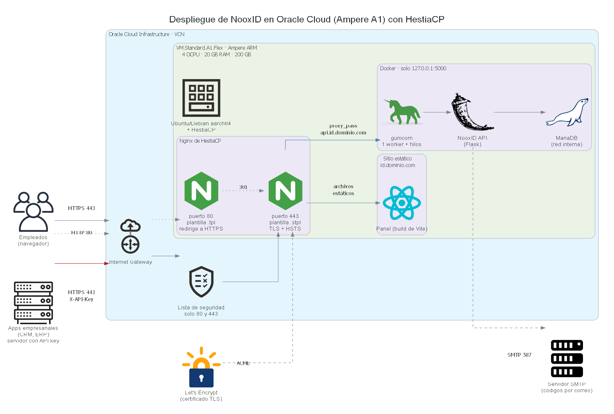

# Despliegue de NooxID: Oracle Cloud Ampere + HestiaCP + Docker

Arquitectura (se dibuja como código con [mingrammer/diagrams](https://diagrams.mingrammer.com/), ver abajo):



La API corre en Docker y escucha **solo en `127.0.0.1:5000`**. La única puerta pública es el Nginx de HestiaCP, que
fuerza HTTPS y HSTS con plantillas propias (`.tpl` para el puerto 80 y `.stpl` para el 443) y hace `proxy_pass` al puerto.

> **Estado de la verificación.** El código de la API y la demo se probaron en local. El `Dockerfile`, el
> `docker-compose.yml` y las plantillas de Hestia **no se han ejecutado todavía en el servidor**: la máquina de
> desarrollo no tiene Docker ni Nginx. La sintaxis del compose se validó como YAML y las variables de las plantillas
> salen de la [documentación de HestiaCP](https://hestiacp.com/docs/server-administration/web-templates). Prueba en
> orden y compara con tu `default.tpl` si algo no encaja.

## 1. Oracle Cloud

1. Instancia **VM.Standard.A1.Flex** (Ampere, arm64) con 4 OCPU, 20 GB de RAM y 200 GB de disco.
2. En la **lista de seguridad** de la subred, deja entrada solo para **80 y 443** (y 22 limitado a tu IP).
3. Abre también 80 y 443 en el firewall del propio sistema (el de HestiaCP o `iptables`): las imágenes de Oracle
   traen reglas que bloquean el tráfico aunque la lista de seguridad lo permita.

## 2. Docker y la API

```bash
# Docker Engine + plugin compose para arm64: https://docs.docker.com/engine/install/
git clone https://github.com/estrosebas/Noox-id.git && cd Noox-id
cp deploy/.env.docker.example deploy/.env.docker      # completa DB_PASSWORD, SECRET_KEY, MAIL_*, CORS_ORIGINS…
docker compose -f deploy/docker-compose.yml --env-file deploy/.env.docker up -d --build

curl http://127.0.0.1:5000/api/health                 # {"status":"OK",...}
ss -ltnp | grep 5000                                   # debe mostrar 127.0.0.1:5000, no 0.0.0.0
```

Primer administrador (el usuario debe haberse registrado y verificado su correo):

```bash
docker compose -f deploy/docker-compose.yml --env-file deploy/.env.docker exec api python manage.py make-admin correo@dominio.com
```

La imagen usa **un solo proceso de gunicorn con hilos**: los contadores de intentos fallidos viven en memoria y no se
comparten entre procesos.

## 3. HestiaCP: plantillas y dominios

Copia las plantillas **sin editar las de fábrica** (las actualizaciones las pisan). Según tu modo de Hestia:

| Modo | Carpeta de plantillas |
|---|---|
| Nginx + PHP-FPM | `/usr/local/hestia/data/templates/web/nginx/php-fpm/` |
| Nginx (proxy) + Apache | `/usr/local/hestia/data/templates/web/nginx/` |

```bash
sudo cp deploy/hestia/noox-proxy.tpl deploy/hestia/noox-proxy.stpl \
        deploy/hestia/noox-spa.tpl   deploy/hestia/noox-spa.stpl  /usr/local/hestia/data/templates/web/nginx/php-fpm/
```

Crea dos dominios en el panel de Hestia y asigna la plantilla en *Editar dominio > Plantilla Web*:

| Dominio | Plantilla | Para qué |
|---|---|---|
| `api.id.dominio.com` | `noox-proxy` | API y SDK (`/sdk/…`): reverse proxy a `127.0.0.1:5000` |
| `id.dominio.com` | `noox-spa` | Panel de NooxID (archivos estáticos del build de Vite) |

1. Activa **SSL con Let's Encrypt** en ambos dominios.
2. Aplica las plantillas: `sudo v-rebuild-user TU_USUARIO` (o la operación en bloque del panel).
3. Panel (en tu máquina o en el servidor):

   ```bash
   cd noox-id && VITE_API_URL=https://api.id.dominio.com npm ci && npm run build
   # sube el contenido de dist/ al docroot de id.dominio.com (…/public_html/)
   ```

4. En `deploy/.env.docker` deja `CORS_ORIGINS=https://id.dominio.com` y reinicia el contenedor `api`.

Las dos plantillas HTTPS ponen `Strict-Transport-Security: max-age=63072000; includeSubDomains` **siempre** y las `.tpl`
redirigen todo el puerto 80 a HTTPS con un 301 (dejando libre `/.well-known/acme-challenge/` para renovar el certificado).

## 4. Comprobaciones

```bash
curl -sI http://api.id.dominio.com/api/health | head -3      # 301 → https
curl -sI https://api.id.dominio.com/api/health | grep -i strict-transport-security
curl -s  https://api.id.dominio.com/api/health               # {"status":"OK",...}
curl -sI https://api.id.dominio.com/sdk/noox-face.js | head -3   # 200 text/javascript
curl -s --max-time 3 http://IP_PUBLICA:5000 || echo "5000 no está expuesto"   # debe fallar
```

## 5. Diagramas como código

`diagramas/arquitectura.py` y `diagramas/despliegue.py` generan los PNG/SVG con **diagrams** (necesita Graphviz,
el binario `dot`, en el PATH):

```powershell
winget install Graphviz.Graphviz            # Windows (en Linux: apt install graphviz; en macOS: brew install graphviz)
cd deploy/diagramas
uv run --with diagrams python arquitectura.py
uv run --with diagrams python despliegue.py
```

Sin instalar nada también se pueden editar en el [playground](https://diagrams.mingrammer.com/) de la documentación.

## Pendiente conocido

- Los límites de intentos y el reto TOTP viven en memoria: con más de un proceso hay que moverlos a Redis o a la base.
- La API no usa `ProxyFix`: si en el futuro se necesita la IP real del cliente, hay que activarlo.
- Copias de seguridad del volumen `db-data` (por ejemplo `mariadb-dump` con cron) y del `SECRET_KEY`.
